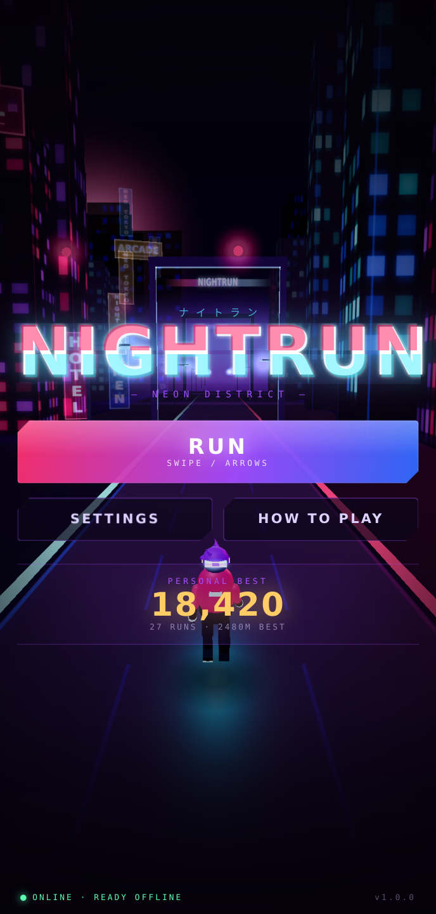
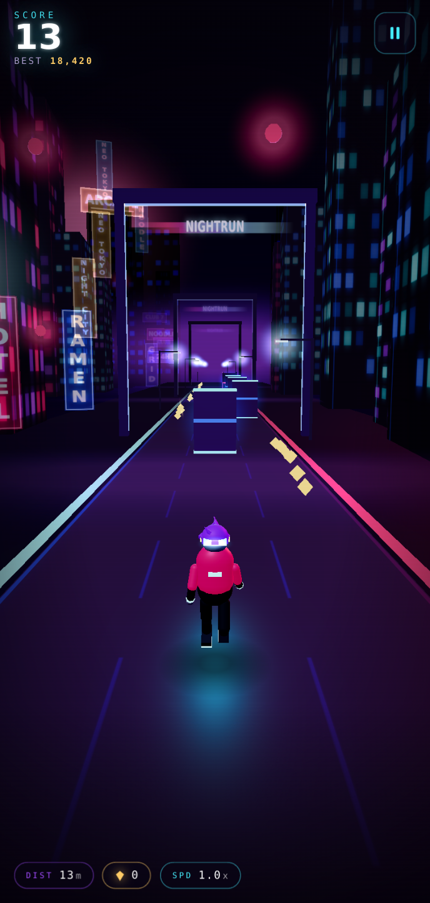
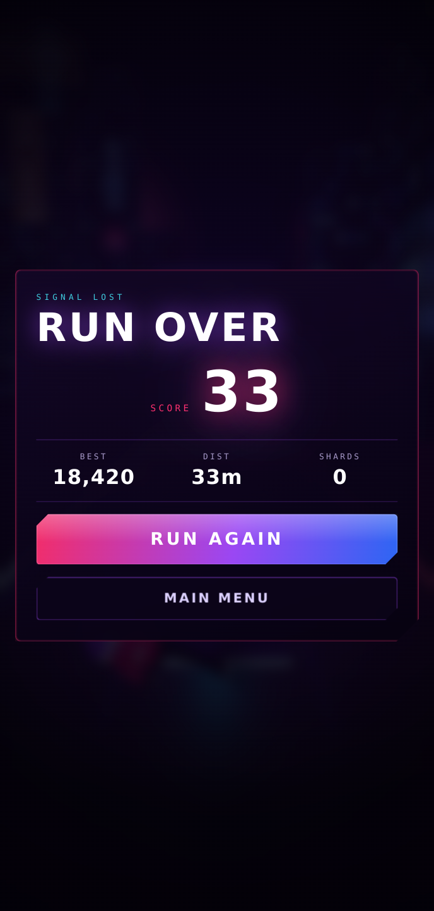
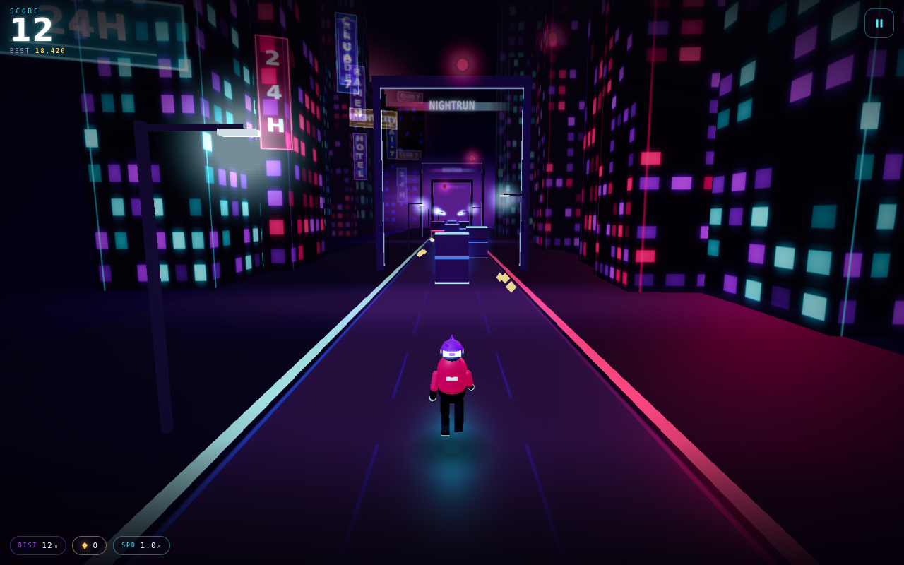

# NIGHTRUN — NEON DISTRICT

A complete, offline-first 3D endless runner for the browser. Third-person chase camera,
three lanes, procedural neon city, original anime-inspired character, and a hand-synthesised
synthwave soundtrack — built with **Three.js + Vite**, no CDNs, no servers, no accounts.

**Play now:** **https://nightrun-five.vercel.app** · repo: `github.com/dyvx/NIGHTRUN`

Hit `RUN` and swipe. It works on a plane, in a tunnel, with the radio off.

<p align="center">
  
  
  
</p>
<p align="center">
  
</p>

---

## Contents

- [Quick start](#quick-start)
- [How to play](#how-to-play)
- [Install as an app (iPhone / Android / desktop)](#install-as-an-app)
- [Offline support](#offline-support)
- [Project structure](#project-structure)
- [Architecture notes](#architecture-notes)
- [Testing](#testing)
- [Performance](#performance)
- [Deploying](#deploying)
- [Assets](#assets)

---

## Quick start

```bash
npm install         # installs three + vite (2 dependencies)
npm run dev         # http://localhost:5173  (dev server, hot reload)
npm run build       # production build -> dist/ (service worker generated here)
npm run preview     # serve the production build at http://localhost:4173
npm test            # build + gameplay suite + offline/PWA suite (headless Chromium)
```

Requirements: Node 18+ (developed on Node 20). The dev server has no service worker on
purpose — offline mode is a production feature, so test it with `npm run preview`.

---

## How to play

| Action | Touch / iOS | Keyboard |
| --- | --- | --- |
| Change lane | Swipe ◀ / ▶ | `←` `→` / `A` `D` |
| Jump | Swipe ▲ | `↑` / `W` / `Space` |
| Slide | Swipe ▼ | `↓` / `S` / `Shift` |
| Pause | ⏸ button | `Esc` / `P` |
| Restart | `RUN AGAIN` | `Enter` on the result screen |

- **Crimson barrier** → jump it.
- **Tall gate with a crimson laser line** → slide under it.
- **Solid blue block** → change lanes; you cannot jump or slide through it.
- **Gold shards** → +12 points each. Distance is +1 point per metre.
- Speed ramps from 15.5 m/s to 41 m/s over several minutes of survival.

Optional on-screen arrow pad: **Settings → On-screen buttons**.

---

## Install as an app

### iPhone / iPad (Safari)

1. Open the deployed URL in **Safari**.
2. Tap **Share → Add to Home Screen**.
3. Launch it from the home screen. It runs full-screen (no browser chrome).
4. Turn on Airplane Mode and launch it again — it plays exactly the same.

The first load caches the whole game (a few hundred KB). Everything after that is local.

### Android / Desktop Chrome / Edge

Use the **Install** prompt in the address bar, or the ⋮ menu → *Install app*.

---

## Offline support

| Requirement | Implementation |
| --- | --- |
| Valid web app manifest | `public/manifest.webmanifest` — `display: fullscreen`, maskable + any-purpose icons, standalone `id`/`scope` |
| Service worker | `public/sw.js`, generated into `dist/sw.js` at build time with a full precache manifest |
| Cache everything | The build plugin walks `dist/` and injects **every** emitted file (JS chunks, CSS, icons, manifest, offline page) into `SW_PRECACHE` |
| Bundled dependencies | `three` and all game code are bundled by Vite; no CDN, no runtime fetch of fonts/images (textures, sprites, music and SFX are generated in the browser) |
| Offline fallback | `public/offline.html`, precached, plus a "bounce to app root" rule so deep links can't resolve to a broken shell |
| Cache versioning | Cache name = `nightrun-v1-<hash of the file list>`; a stale cache is deleted on activation |
| Updates don't destroy progress | Progress lives in `localStorage` (`nightrun.save.v1`), a separate storage area from the Cache API. A new worker activates on the next launch and never touches saves |
| No account / API | Nothing leaves the device; the only network traffic is the initial asset download |

**Verified, not assumed** — see `tools/test-offline.mjs`: it boots the built app, waits for the
worker to control the page, checks every precached URL is really in the Cache API, then sets
the browser **offline** and verifies reload, gameplay, pause/resume, progress persistence,
"close and reopen", deep-link fallback, and a cache-pruning update cycle. 32 assertions.

---

## Project structure

```
nightrun/
├── index.html                 # UI shell: HUD, menu, pause, game over, settings, how-to
├── vite.config.js             # build config + service-worker precache generator
├── vercel.json                # static hosting headers (SW revalidation, asset caching)
├── public/
│   ├── manifest.webmanifest
│   ├── sw.js                  # service worker template (manifest injected at build)
│   ├── offline.html           # offline fallback page
│   └── icons/                 # generated PNG icons + favicon.svg
├── src/
│   ├── main.js                # boot sequence, UI wiring, test/debug API
│   ├── pwa.js                 # service worker registration / update lifecycle
│   ├── style.css              # the whole interface (no external fonts)
│   └── game/
│       ├── Game.js            # state machine, loop, camera, scoring, quality
│       ├── World.js           # neon district: sky, road, buildings, signs, lamps
│       ├── Player.js          # KAI-7 model + procedural animation + physics
│       ├── Field.js           # obstacle/collectible pools + fair spawner
│       ├── Input.js           # swipe / pointer / keyboard / on-screen pad
│       ├── Audio.js           # procedural music + SFX (Web Audio, zero files)
│       ├── Storage.js         # versioned local save (best score, settings)
│       ├── UI.js              # DOM layer for all screens
│       ├── Textures.js        # canvas-generated road/facade/sign/glow textures
│       ├── constants.js       # every tuning value in one place
│       └── utils.js           # math helpers
├── tools/
│   ├── make-icons.py          # regenerates the icon set (Pillow)
│   ├── serve.mjs              # static server for dist/ (used by the tests)
│   ├── test-game.mjs          # gameplay suite (48 assertions)
│   ├── test-offline.mjs       # offline/PWA suite (32 assertions)
│   ├── test-fairness.mjs      # procedural fairness audit (12 assertions)
│   └── shots.mjs              # screenshot harness for visual review
└── dist/                      # production build (git-ignored)
```

---

## Architecture notes

**Game loop** — one `requestAnimationFrame` loop in `Game.js`. `dt` is clamped to 1/30 s so a
stalled tab can never teleport the player through an obstacle; difficulty scales with elapsed
run time, and speed is smoothed exponentially (~1 s) so no step is ever felt as a jolt.

**Collision** — swept AABB along the travel axis: each frame tests the *interval* an obstacle
crossed rather than its final position, so nothing can tunnel through the player at 41 m/s.
Colliders are intentionally ~13 cm narrower than the visual mesh so a near-miss feels like a
near-miss, never a cheat. Jump clears a 0.62 m barrier with 5 cm of margin; a gate's underside
(1.46 m) is above a sliding player (0.82 m) and behind a standing one (1.72 m), so *only*
sliding survives a gate.

**Fair generation** — `Field._spawnRow` never blocks all three lanes (the one exception is a
full-width gate row, which is rare, slide-solvable, and always preceded and followed by extra
spacing). Rows are spaced by *time*, not distance, so the reaction window shrinks smoothly with
speed instead of collapsing. Reward trails are spawned between rows so a shard is never inside
an obstacle. `tools/test-fairness.mjs` audits thousands of generated rows against these rules
and then hands the controller to an autopilot that plays with human inputs only.

**Pooling** — obstacles, shards, street lamps, buildings and signs are all pre-allocated and
recycled; the gameplay loop allocates no objects. Textures are canvas-generated once and cached
in `Textures.js`. Six consecutive restarts in the test suite grow the JS heap by ~0 MB.

**Rendering** — deliberately light: no shadow maps, no post-processing, no per-frame material
creation. Neon comes from emissive/unlit materials, so the look survives on a mobile GPU.
Obstacle neon is `fog: false` so hazards stay readable in the haze (a fairness decision, not
just an aesthetic one). Device pixel ratio is capped per quality preset, and rendering stops
entirely while paused.

**Audio** — the entire soundtrack is synthesised at runtime with the Web Audio API (kick,
snare, hats, acid bass, delayed arpeggio, pads) plus procedural SFX. Zero audio bytes in the
build, and it works offline by definition.

---

## Testing

```bash
npm run build
node tools/test-game.mjs        # 48 assertions — gameplay
node tools/test-offline.mjs     # 32 assertions — offline / PWA
node tools/test-fairness.mjs    # 12 assertions — procedural fairness
npm test                        # build + the first two suites
npm run test:live               # 12 assertions against the deployed URL
```

Latest run: **48/48 gameplay**, **32/32 offline**, **12/12 fairness**, **12/12 live**.

All three suites drive the **built** app in headless Chromium with real WebGL. What they cover:

| Area | Verified behaviour |
| --- | --- |
| Boot | WebGL context, menu renders, play button interactive |
| Movement | lane switch + clamp for keys *and* swipes, on-screen pad steering |
| Jump | leaves the ground, apex clears the barrier, lands and resumes the run |
| Slide | hitbox drops under gate height, recovers to running |
| Scoring | distance + shard score accrue; HUD matches the result screen |
| Death | real collision ends the run, results screen appears |
| Persistence | best score written to `localStorage`, survives reload and offline reload |
| Restarts | three clean restarts, six more for leak checking |
| Pause | button and `Esc`, simulation frozen, resume continues the same run |
| Responsive | portrait → landscape → 320×568, all keep playing |
| Quality | LOW/HIGH presets apply at runtime with no console errors |
| Offline | worker controls the page, 16/16 assets cached, plays with the network off |
| Updates | stale caches pruned, saved progress intact |
| Hygiene | no cross-origin requests, no runtime console errors |

Frame pacing in CI is measured on **software** GL (SwiftShader) at ~1 dpr, so the absolute FPS
number there is a floor, not a phone benchmark — on an iPhone 13 Pro Max the game runs at 60 fps
with the HIGH preset (4 draw-call-heavy subsystems are pooled and the scene stays under ~150
draw calls).

---

## Performance

- Object pools for every repeating object; zero allocations per frame in the hot path.
- No shadow maps, no post-processing, no per-frame texture/material creation.
- `powerPreference: high-performance`, canvas `antialias: false` (neon art doesn't need it),
  device pixel ratio capped (2.2 max, 1.35 typical on phones).
- Quality presets: **LOW / MED / HIGH**, plus `auto` (default) which picks by device.
- Camera never re-parents; the world translates instead, so the player object stays cheap.
- Simulation pauses on `visibilitychange`/`blur`, and resumes with a clamped delta.

---

## Deploying

Any static host works. The build is fully self-contained (`base: './'`), so sub-paths are fine.

**Vercel**

```bash
npm i -g vercel
vercel            # preview
vercel --prod     # production
```

`vercel.json` is committed with the framework preset, cache headers, and the service-worker
revalidation rule (`sw.js` must not be cached long-term or updates never land).

**Netlify / GitHub Pages / S3** — publish the `dist/` folder. Nothing else required.

---

## Assets

Everything is original and generated locally:

- **KAI-7**, the courier: built from Three.js primitives with procedural animation (run cycle,
  tuck-jump, slide, scarf flutter, thruster pulse). No model files.
- **Textures**: asphalt, lane dashes, neon rails, building facades, Japanese-style vertical
  signage, holograms, glow sprites, sky gradient — all drawn to canvas at runtime.
- **Audio**: synthwave loop + SFX synthesised with Web Audio oscillators and noise buffers.
- **Icons**: `tools/make-icons.py` (Pillow) renders the app icon set deterministically.

No third-party art, music, models or fonts are used, and no network requests are made at runtime.

---

*NIGHTRUN — NEON DISTRICT · v1.0.0*
